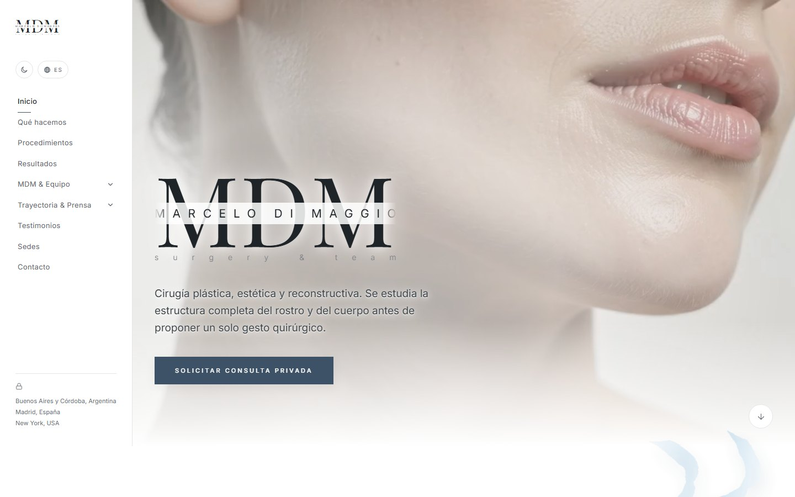

# MDM Surgery

Sitio web del Dr. Marcelo Di Maggio: cirugía plástica, estética y reconstructiva, con sede en Buenos Aires, Córdoba, Madrid y Nueva York.

🌐 **[mdmsurgery.com](https://mdmsurgery.com)**



Landing institucional en una sola página: presenta al equipo médico, las áreas de trabajo (armonización, reafirmación de género, rejuvenecimiento facial y corporal), el listado completo de procedimientos con casos de antes/después, trayectoria y prensa, testimonios de pacientes, sedes y un formulario de contacto.

## Características

- **Bilingüe (ES/EN)**: todo el contenido, incluida la localización de nombres propios (sedes, ciudades), cambia con un solo toggle.
- **Modo claro / oscuro**, con persistencia en `localStorage` y detección de preferencia del sistema.
- **Accesibilidad**: respeta `prefers-reduced-motion` en toda animación, foco de teclado visible en todo el sitio y contraste de color verificado contra WCAG AA.
- **Galería de resultados** con filtro por procedimiento, casos con varios ángulos y comparación antes/después; las fotos sensibles salen difuminadas hasta que la visita decide verlas.
- **Equipo médico**: retrato del doctor con fotos que rotan solas (fundido suave), credenciales separadas en especialidades y matrículas, equipo quirúrgico y asistentes.
- **Testimonios** en un mazo de tarjetas: la del medio destaca y las demás quedan detrás; se pasa con flechas, arrastrando o con el teclado.
- **Riel de procedimientos** con scroll horizontal dentro de la sección.
- **Formulario de contacto** funcional vía [Formspree](https://formspree.io/), con estado de carga y confirmación de envío.
- **Editor de fotos integrado** (ver más abajo): el consultorio acomoda, reemplaza, agrega y quita fotos de Resultados desde el propio sitio, sin tocar código.
- **Diseño responsive** de punta a punta: sidebar fijo en escritorio y menú lateral deslizable en celular.

## Stack técnico

| | |
|---|---|
| **Framework** | [React 18](https://react.dev/) + [Vite 5](https://vitejs.dev/) |
| **Estilos** | [Tailwind CSS v4](https://tailwindcss.com/) |
| **Animación** | [Framer Motion](https://www.framer.com/motion/) |
| **Íconos** | [lucide-react](https://lucide.dev/) + un set de íconos SVG propios (`src/icons.jsx`) |
| **Tipografía** | Playfair Display, Inter, Cormorant Garamond y Mrs Saint Delafield, autoalojadas con [Fontsource](https://fontsource.org/) |
| **Formulario** | [Formspree](https://formspree.io/) |
| **Hosting** | [Netlify](https://www.netlify.com/): sitio estático + funciones del editor |
| **Backend del editor** | Netlify Functions + [Netlify Blobs](https://docs.netlify.com/build/data-and-storage/netlify-blobs/) (borrador) + API de Git de GitHub (publicar) |
| **Imágenes** | WebP en todo el sitio |

El sitio que ven las visitas es estático. Lo único con servidor son las tres funciones del editor de fotos (`/api/login`, `/api/borrador` y `/api/publicar`).

## Estructura del proyecto

```
src/
├── App.jsx            # Componente principal: todas las secciones y el editor de fotos
├── data.js            # Contenido: procedimientos, equipo, sedes, testimonios, etc.
├── i18n.js            # Textos de interfaz en español e inglés
├── icons.jsx          # Set de íconos SVG propios
├── index.css          # Tokens de diseño (variables CSS) y estilos globales
├── encuadre.json      # Encuadre, tamaño de recuadro, censura y orden de cada foto de caso
└── assets/
    ├── doctor/        # Fotos del Dr. Di Maggio (marcelodimaggio.webp, marcelodimaggio1.webp, ...)
    ├── procedimientos/<procedimiento>/<caso>/   # Fotos de casos (antes/después)
    └── ...            # Video del hero, certificados, papers, texturas
netlify/functions/     # login, borrador y publicar (editor de fotos)
netlify.toml           # Build, redirect de /api y encabezados de seguridad
docs/                  # Contexto del proyecto, auditorías y borradores legales
public/                # Favicon, imagen para compartir, robots y sitemap
```

### Cambiar las fotos del doctor

Las fotos de la sección del doctor son todas las de `src/assets/doctor/`. Para sumar una, dejala ahí como `marcelodimaggio<número>.webp` (recorte con fondo transparente, unos 800×1200 px) y se agrega sola a la rotación. Conviene comprimirla: una foto no debería pasar de ~200 KB.

## Desarrollo

```bash
npm install       # instalar dependencias
npm run dev       # servidor de desarrollo (incluye el editor de fotos, que escribe en disco)
npm run build     # build de producción (carpeta dist/)
npm run preview   # previsualizar el build de producción
```

> **Ojo con `npm run dev`:** en desarrollo el editor guarda las fotos y encuadres directamente en tu carpeta, y su botón de publicar hace `git commit` y `git push`. Probalo en una copia o descartá los cambios (`git restore`) antes de subir nada.

## Editor de fotos

Desde el candadito del pie de página, con la contraseña, el consultorio puede editar la sección Resultados:

- mover, acercar y alejar cada foto, y cambiar la forma del recuadro del par;
- reemplazar, recortar, difuminar los ojos o tapar una foto;
- agregar y quitar casos, ordenarlos y elegir en qué procedimientos aparece cada uno;
- intercambiar el antes y el después, y deshacer.

Lo que se acomoda se guarda solo como **borrador** en la nube (no cambia el sitio público). Al tocar el botón de la nube, el sitio hace un solo commit en GitHub y Netlify lo publica.

Variables de entorno en Netlify (se cargan solo allí, nunca en el repositorio):

| Variable | Para qué |
|---|---|
| `EDITOR_PASSWORD` | Contraseña del editor (y firma de las sesiones de 12 horas) |
| `EDITOR_GITHUB_TOKEN` | Token de GitHub con permiso de escritura (*Contents*) solo sobre este repositorio |

## Deploy

Cada push a `main` dispara un deploy en Netlify (cuesta créditos del plan: conviene agrupar los cambios en un solo push). Configuración en `netlify.toml`: build `npm run build`, carpeta `dist`, funciones en `netlify/functions`.

## Documentación

- [`docs/MDM_SURGERY_CONTEXT.md`](docs/MDM_SURGERY_CONTEXT.md): estado actual del proyecto, decisiones y pendientes.
- [`docs/audits/`](docs/audits): auditorías de ciberseguridad, legal/privacidad y UX/UI.
- [`docs/legal/`](docs/legal): borradores legales y puntos pendientes de revisión por un abogado.
- [`SECURITY.md`](SECURITY.md): cómo avisar de un problema de seguridad.

## Licencia

**Todos los derechos reservados.** El código fuente y el diseño son © 2026 Emma Aimetta; las fotografías (incluidas las de pacientes), los textos médicos, los logotipos y la marca son © 2026 Marcelo Di Maggio / MDM Surgery. Nada puede copiarse ni reutilizarse sin autorización por escrito del titular que corresponda. Ver [`LICENSE`](LICENSE).

Las librerías de terceros conservan sus propias licencias: ver [`THIRD_PARTY_LICENSES.md`](THIRD_PARTY_LICENSES.md).

## Créditos

Página hecha por [Emma A.](https://portfolio-emma-aimetta.vercel.app/)
